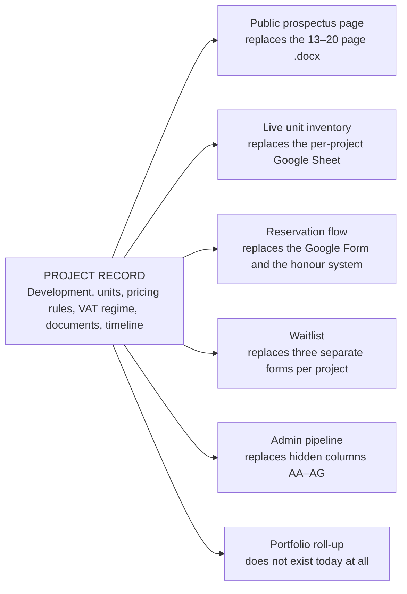
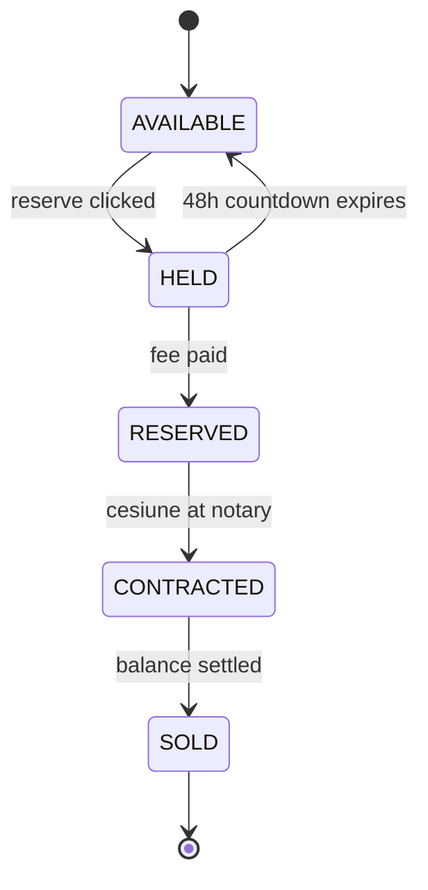

# A single source of truth per project

> [!NOTE]
> Proposal · Working title: Hubix Portal

Hubix runs six live projects out of Word documents, Google Sheets, Google Forms and WhatsApp. The
proposal is not to digitise that. It is to collapse it.

> **The thesis**
>
> Every project fact is currently typed into five places and kept in sync by hand. Enter it once,
> render it everywhere — prospectus, live inventory, reservation, waitlist, pipeline, portfolio.
> Everything else in this proposal follows from that one move.

---

## Why this, and why now

The analysis turned up two contradictions sitting in *live* files: the Roka prospectus says 20
apartments in one section and 30 in another, and the Cartierul Vienez spreadsheet has its header row
pasted over. Neither is carelessness. Both are the arithmetic of hand-syncing five artefacts across
six projects.

That failure mode gets worse, not better, as they scale. They expect **6–9 more Equity projects this
year** and 15–25 SPVs within two years. The manual process is already at its ceiling.

Meanwhile the thing that actually protects revenue — a unit being genuinely locked when someone
reserves it — is enforced today by a person remembering to type `NU` in a cell. That is the gap
worth closing first.

---

## One record, six surfaces

The whole architecture is this diagram. A project is entered once; every artefact is a rendering of
it.



The last one matters more than it looks. Because every sheet has a different column layout, Hubix
currently **cannot answer "how many units are unsold across all six projects"** without opening six
files and reading them by eye. One schema makes that a query.

---

## The three hard parts

Most of this application is CRUD. Three pieces are not, and they are where the value concentrates.

### 1. The unit state machine

This is the revenue-protecting piece and the thing to demo first.



| State | Meaning |
|---|---|
| `AVAILABLE` | listed publicly |
| `HELD` | 48h countdown |
| `RESERVED` | fee paid |
| `CONTRACTED` | cesiune at notary |
| `SOLD` | balance settled |

HELD expires automatically → back to AVAILABLE, and the waitlist is notified in position order. A
prospect who lets a hold lapse is flagged — the documents already describe this rule, enforced by
memory today.

The entire trick is that the hold must be atomic. One conditional write, and you check whether it
actually changed a row:

```sql
-- two people click Reserve on Ap.203 in the same second.
-- exactly one of them gets a rowcount of 1.
UPDATE units
   SET state      = 'held',
       held_by    = $1,
       held_until = now() + interval '48 hours'
 WHERE id = $2
   AND state = 'available';   -- the guard. everything depends on this line.
```

A scheduled job every minute expires lapsed holds and promotes the waitlist. That is the complete
mechanism — perhaps 150 lines including the notifications, and it removes an entire class of
double-booking that today is prevented only by Cristian being fast.

### 2. The pricing engine

Column drift between the five spreadsheets is not a formatting problem; it is a symptom of every
tranche being typed by hand. The fix is to make those columns **derived, never entered**.

A project carries a pricing rule — advance percentage, cesiune basis, VAT regime, tranche count. A
unit carries a base price, its own square metres, and any override. Tranche 1, the cesiune price and
the balance are computed. Roka's `Transa 1 / Transa 3` and Prima Solis's `Transa 1 / Transa 2` stop
being different schemas and become the same rule with a different tranche count.

VAT deserves calling out: 9% / 19% / 21% depending on unit and buyer type, and it is a real column
in their sheets. It has to be modelled per unit with the buyer type resolved at reservation, not
assumed globally.

### 3. Documents bound to units, not pasted per row

Every row in every sheet carries hand-pasted Drive links — `Plan Etaj`, `RLV Apartament`,
`Plan de situatie`, renders. These belong to the unit and the floor, not to a cell. Upload the floor
plan once against the floor; every unit on it inherits the link. This is unglamorous and it deletes
a large share of the manual work.

---

## In scope, and firmly out

The out-of-scope list is the more useful half. Each of these is a plausible-sounding feature that
would sink a solo build.

**Build**

- Project and unit records with a real schema
- Public project pages, Romanian-first
- Live inventory with atomic holds
- Reservation and waitlist with auto-promotion
- Admin pipeline board
- Document vault per project and floor
- Transactional email in Romanian
- Portfolio dashboard
- Audit log on every state change

**Do not build**

- **Payments.** Money moves by bank transfer and notary. Track state, never hold funds — that is a
  licensing question.
- **A WhatsApp replacement.** It is load-bearing for their community. Link out to it.
- **Property management operations.** Different product, different buyer.
- **A CRM.** A few hundred prospects. The pipeline board covers it.
- **E-signature.** The cesiune is signed at a notary by law.

---

## Build order

Sequenced for one person building alone, with a demonstrable artefact at every stop. Durations
assume evenings and weekends, not full-time.

### Phase 0 — The moment · 2–3 weeks

One project, their real data, one screen that makes the point. This is a pitch artefact, not a
product — hardcode whatever you like.

- Load Roka Park View's actual 20 units from the spreadsheet
- Public project page and live inventory grid
- Reserve a unit → it locks, greys out for everyone, countdown starts
- Bare-bones admin to watch it happen from the other side

### Phase 1 — One project, end to end · 4–6 weeks

Everything Hubix does for a single project, done in the app instead of across five artefacts.

- Spreadsheet importer — they will not retype 180 units, and should not have to
- Waitlist with automatic promotion on hold expiry
- Pipeline board replacing columns AA–AG, including the notary fields
- Document vault, transactional email, full audit log
- Magic-link accounts for prospects — no passwords

### Phase 2 — All six projects · 4–6 weeks

Multi-project, and the prospectus stops being a Word file.

- Prospectus rendered from the project record — the 20-vs-30 problem becomes impossible
- Portfolio dashboard across all projects
- Sheets export, so they can leave whenever they want and know it
- Project templating from the existing six as the model

### Phase 3 — Equity — gated on legal advice · not yet

> [!CAUTION]
> Do not start this until a Romanian securities lawyer has reviewed the design. The 149-subscriber
> cap is a regulatory boundary, not a business rule, and a browsable deal page could constitute a
> public offer.

- Invitation-only access, granted per project, logged per view
- Hard-stop subscriber counter — refuses the 150th, does not warn
- Subscription windows and the allocation queue by priority tier
- Capital call tracking and semi-annual shareholder reporting

---

## Stack

Chosen for the constraint that matters most on a solo build: fluency. This is a .NET stack because
that is where the developer is fastest, and on a side project the largest risk is stalling.

| Layer | Choice | Why this one |
|---|---|---|
| Backend | `ASP.NET Core (.NET 10)` | One host serves the public site, the admin API and the background worker |
| Database | `Azure SQL / SQL Server` | The atomic hold needs real row locks. Filtered indexes and persisted computed columns cover everything the schema needs |
| Data access | `EF Core` | Strong migrations; `ExecuteUpdateAsync` returns a row count, so the hold guard stays explicit |
| Public pages | `Razor Pages` | Server-rendered, indexable, fast first load — prospects share these links |
| Admin UI | `React + TypeScript (Vite)` | The units grid and pipeline board are genuinely app-like; this is where React earns its place |
| Auth | `ASP.NET Identity + magic links` | Staff sign in properly; prospects get passwordless links. Per-view access logging comes free, which Equity will need |
| Jobs | `Hangfire` | Hold expiry and waitlist promotion. Persists in the same database, retries, distributed lock, dashboard included |
| Email | `Postmark or Azure Comms` | Romanian templates, deliverability that can be verified |
| Files | `Azure Blob Storage` | Floor plans and renders. SAS URLs matter for Equity later |
| Hosting | `Azure App Service` | Cheap, boring, and the database sits next to it |

The only choice that carries real weight is a database with proper row locking, which SQL Server and
Postgres both provide. Everything else is substitutable — including running the whole front end as a
React SPA, at the cost of needing prerendering for the public routes later.

---

## What will bite

- **Romanian first, not "i18n later".** Every buyer, every document, every legal term is Romanian —
  *cesiune*, *transa*, *promisiune de vanzare-cumparare*. Retrofitting language is expensive;
  starting Romanian and adding English is not. Diacritics in names and cities need to work on day
  one.
- **They will not abandon Sheets on trust.** Import *and* export from the first week. The export is
  a comfort blanket that costs a day and removes the main objection.
- **GDPR is already on their mind.** The Equity document explicitly promises the prospect database
  is used only for that purpose. Consent capture, purpose tagging and deletion need to be in the
  schema from the start, not bolted on.
- **Equity is a regulated private placement.** Max 149 privately invited subscribers per project,
  and Hubix deliberately refuses to disclose deals in advance. A public listing page there is a
  legal problem, not a design one. This is why it is last.
- **You are building without a client.** Every assumption about their process comes from reading
  documents, not from watching Cristian work. Expect the pipeline model to be wrong in at least one
  important way, and design the schema so states are configurable.

---

## How to land it

You are an investor building unsolicited software for a company that has not asked for it. That
shapes the first conversation more than any feature does.

**Lead with the two errors, not the demo.** Open by showing that the Roka prospectus says 20
apartments in one place and 30 in another, and that Cartierul Vienez's header row is corrupted. You
found those by reading files they sent to real prospects. It establishes that you understand their
operation before you propose changing it.

**Then show one screen.** Their own Roka units, live. Click reserve. Watch it lock with a countdown
on a second device. Say nothing while it happens.

**Ask for one project, not the business.** Propose running the next launch in parallel — the app
alongside the spreadsheet, both maintained, for one project. It is a small ask, it de-risks the
decision entirely, and the spreadsheet quietly stops being updated within two weeks.

Keep Equity out of the first conversation. It is the bigger prize and the reason to build this, but
leading with the regulated product invites a legal objection before anyone has seen the thing work.

---

## Your calls

Three things I would not decide for you.

**1. Is this a pitch demo or a production system?**

It changes almost everything about how Phase 0 gets built. A demo can hardcode, skip auth and fake
the emails; a production system cannot, and the cost difference in the first month is roughly
threefold.

*Recommendation: build the demo first.*

**2. Line A only, or both lines?**

Hubs is the operational pain and the safe demo. Equity is the strategically interesting product —
recurring subscriptions, shareholder reporting, a real moat — and the one you have personal exposure
to as an investor. But it needs a securities lawyer before design, not after.

*Recommendation: Line A first, Equity designed in parallel on paper.*

**3. Do you tell Hubix before or after Phase 0?**

Building further in silence risks modelling their process wrong for months. Telling them now costs
you the demo's impact and invites a committee. There is a middle path: two weeks to the Roka screen,
then show it.

*Recommendation: show them at the end of Phase 0.*

---

*Proposal prepared 31 August 2026 · builds on [01-business-analysis](01-business-analysis.md).
Estimates assume a single developer working part-time. No Hubix input has informed this document.*
