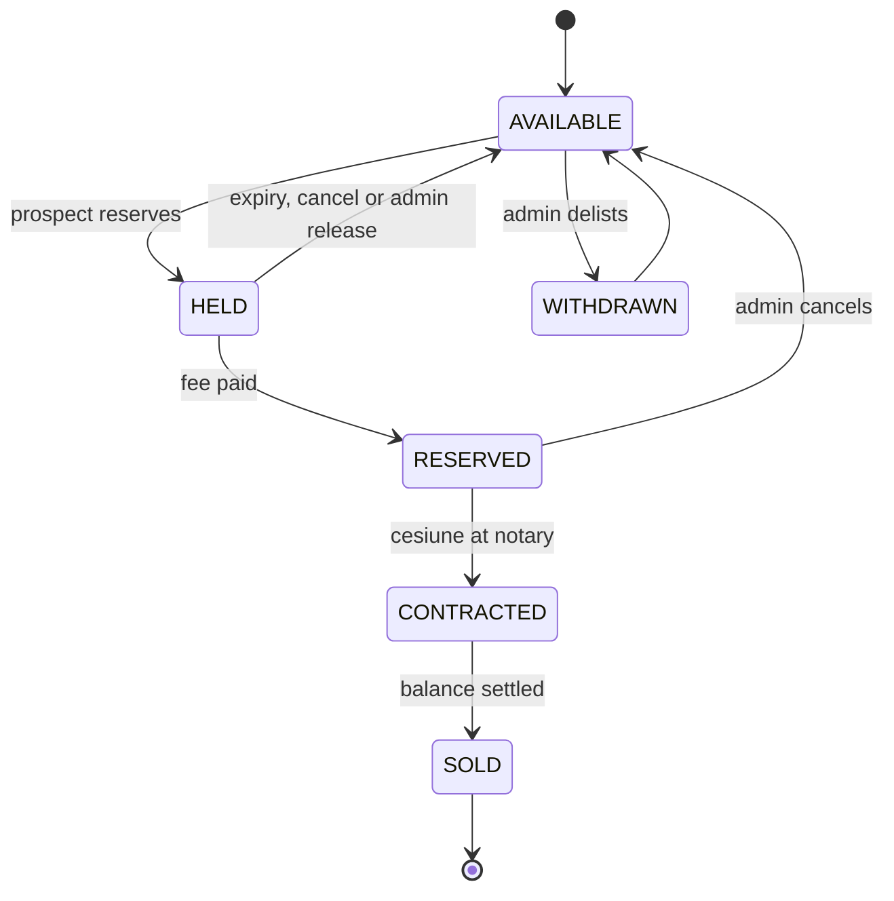

# Hubix Portal Spec

> [!NOTE]
> Build specification · Line A

The schema, the state machine and the build order for a production system that replaces the
per-project spreadsheet, form and prospectus with one record.

| | |
|---|---|
| **Target** | Production, not a demo |
| **Scope** | Line A — Hubs only |
| **Reveal** | After first deploy |
| **Pace** | Side project, unhurried |
| **Stack** | .NET · EF Core · SQL Server · React |

---

## What's locked, and what that changes

Choosing production over a demo changes four things immediately, and it's worth being explicit about
them because they're the difference between a weekend prototype and something Hubix can actually run
a launch on.

- **Money is snapshotted, never recomputed.** A reservation stores the prices that applied when it
  was made. Prices change; history must not.
- **Every state change is audited.** Who released that hold, when, and why — that question will be
  asked, and "the spreadsheet doesn't say" is the current answer.
- **Consent is in the schema from migration one.** Retrofitting GDPR onto a live prospect table is
  genuinely painful.
- **Romanian is the default locale**, English is the translation. Not the other way round.

Because you have time and want to learn from this, the spec below is deliberately schema-first. Get
the model right and most of the application is generated from it; get it wrong and every screen
inherits the mistake.

---

## Data model

Written as plain SQL because it reads clearly. The build is **EF Core against SQL Server** — see the
translation notes at the end of this section. Every table gets an `id uuid` primary key,
`created_at` and `updated_at`; omitted below for brevity.

### Projects, buildings, units

**projects**

```sql
CREATE TABLE projects (
  slug                  text UNIQUE NOT NULL,      -- 'roka-park-view'
  name                  text NOT NULL,
  city                  text NOT NULL,
  developer_id          uuid REFERENCES developers,
  status                project_status NOT NULL DEFAULT 'draft',
  units_committed       int,                         -- the 20-vs-30 field. ONE place.
  delivery_date         date,
  delivery_grace_months int DEFAULT 0,                 -- Roka: 6
  rental_profile        rental_profile,                -- short | mid | long | mixed
  reservation_fee       numeric(12,2),                 -- 1000 / 4000 / 5000 EUR
  currency              char(3) DEFAULT 'EUR',
  hold_duration_hours   int  DEFAULT 48,            -- their "1-2 days"
  penalty_clause        text,                          -- varies wildly; prose, not a number
  maps_url              text,
  summary_ro            text,
  body_ro               jsonb,                         -- rich text, renders the prospectus
  published_at          timestamptz
);

CREATE TYPE project_status AS ENUM
  ('draft','upcoming','selling','sold_out','delivered','archived');
```

`units_committed` is a small field carrying a large point. It exists once, the prospectus reads it,
and the "20 apartments here / 30 apartments there" contradiction becomes structurally impossible.

**units**

```sql
CREATE TABLE units (
  project_id      uuid NOT NULL REFERENCES projects ON DELETE CASCADE,
  crt             int,                        -- their "Nr Crt", kept for cross-reference
  code            text NOT NULL,              -- 'Ap.203'
  building        text,                       -- 'Bloc F'   nullable: not every project has one
  stair           text,                       -- 'Scara 1'  nullable
  floor_level     int,                        -- 2          numeric, so it sorts
  unit_type_id    uuid NOT NULL REFERENCES unit_types,
  orientation     text,                       -- 'S-W'

  area_built      numeric(8,2),               -- MPC
  area_usable     numeric(8,2) NOT NULL,      -- MPU
  area_balcony    numeric(8,2) DEFAULT 0,
  area_total      numeric(8,2) GENERATED ALWAYS AS
                    (area_usable + COALESCE(area_balcony,0)) STORED,

  base_price_net    numeric(12,2) NOT NULL,   -- Pret total apartament fara TVA
  cesiune_price_net numeric(12,2),              -- HUBIX's margin on this unit
  reduced_vat_eligible boolean DEFAULT false,  -- their "TVA redus?" column

  parking_available    boolean DEFAULT false,
  parking_price_net    numeric(12,2),
  parking_advance_net  numeric(12,2),

  state             unit_state NOT NULL DEFAULT 'available',
  state_changed_at  timestamptz NOT NULL DEFAULT now(),
  admin_notes       text,

  UNIQUE (project_id, code)
);

CREATE TYPE unit_state AS ENUM
  ('available','held','reserved','contracted','sold','withdrawn');
```

> [!TIP]
> **Worth understanding.** `area_total` is a **generated column** — Postgres computes and stores it,
> and it can never disagree with its inputs. Their spreadsheets have this as a typed formula that
> some rows have lost. Any value that is a pure function of other columns should be generated, not
> stored.

Note what is *absent* from `units`: no tranche columns. That is deliberate, and it's the fix for the
column drift across their five sheets.

### Pricing and tranches

Roka has `Transa 1 / Transa 3`. Prima Solis has `Transa 1 / Transa 2` plus parking columns.
Cartierul Vienez has a 18.2% advance with 21% VAT; Coresi has 27%. These aren't five schemas —
they're one rule with different parameters.

**pricing_rules — one active per project, versioned**

```sql
CREATE TABLE pricing_rules (
  project_id      uuid NOT NULL REFERENCES projects,
  advance_pct     numeric(5,4) NOT NULL,     -- 0.1400 | 0.1820 | 0.2700
  cesiune_vat_pct numeric(5,4) NOT NULL,     -- 0.1900 | 0.2100
  vat_standard    numeric(5,4) NOT NULL,     -- 0.1900 | 0.2100
  vat_reduced     numeric(5,4),                -- 0.0900, where it applies
  tranches        jsonb NOT NULL,
  effective_from  timestamptz NOT NULL DEFAULT now()
);

-- tranches, for Roka:
-- [ {"label":"Transa 1","basis":"advance_pct","with_cesiune":true, "due":"at_signing"},
--   {"label":"Transa 3","basis":"remainder",  "with_cesiune":false,"due":"at_delivery"} ]
```

The `label` is stored rather than derived so their existing vocabulary survives — a sheet that says
*Transa 3* keeps saying *Transa 3*, even though it's the second payment. Preserving the client's
language costs one string and buys a lot of goodwill.

Tranche amounts are then **computed, never entered**:

```
advance_net   = base_price_net × advance_pct
cesiune_gross = cesiune_price_net × (1 + cesiune_vat_pct)
tranche_1     = advance_net + cesiune_gross
remainder_net = base_price_net − advance_net
vat_rate      = reduced_vat_eligible AND buyer qualifies
                  ? vat_reduced : vat_standard   -- resolved at reservation
```

> [!TIP]
> **Worth understanding.** VAT can't be resolved on the unit alone — it depends on the *buyer*
> (individual vs company, and whether they qualify for the reduced rate). So the unit stores
> eligibility; the reservation stores the rate that was actually applied. Modelling "a fact about
> the thing" separately from "a fact about this transaction" is the move that keeps the schema
> honest.

### Holds, reservations, waitlist

**holds — short-lived, one active per unit**

```sql
CREATE TABLE holds (
  unit_id        uuid NOT NULL REFERENCES units,
  prospect_id    uuid NOT NULL REFERENCES prospects,
  expires_at     timestamptz NOT NULL,
  released_at    timestamptz,
  release_reason hold_release   -- expired | cancelled | converted | admin
);

CREATE UNIQUE INDEX one_active_hold_per_unit
  ON holds (unit_id) WHERE released_at IS NULL;
```

> [!TIP]
> **Worth understanding.** That's a **partial unique index** — uniqueness enforced only over rows
> matching the `WHERE`. It makes "a unit can have many historical holds but only one live one" a
> database guarantee rather than application discipline. Belt and braces alongside the guarded
> update below.

**reservations — replaces hidden columns AA–AG**

```sql
CREATE TABLE reservations (
  unit_id      uuid NOT NULL REFERENCES units,
  prospect_id  uuid NOT NULL REFERENCES prospects,
  state        reservation_state NOT NULL DEFAULT 'pending_fee',

  contract_number            text,        -- "Numar contract"
  fee_paid_at                timestamptz,  -- "Platit rezervare"
  signed_agreement_at        timestamptz,  -- "Trimis rezervarea semnata"
  cesiune_signed_at          timestamptz,  -- "Cesiune semnata la NOTAR"
  notary_location            text,        -- "Locatie cesiune"
  notary_appointment_at      timestamptz,

  buyer_type   buyer_type NOT NULL,      -- individual | company

  -- price snapshot: what applied WHEN THIS WAS AGREED
  snap_base_price_net   numeric(12,2) NOT NULL,
  snap_cesiune_net      numeric(12,2),
  snap_vat_rate         numeric(5,4)  NOT NULL,
  snap_tranches         jsonb         NOT NULL,

  internal_notes      text,             -- was "Comments Istratescu"
  cancelled_at        timestamptz,
  cancellation_reason text
);

CREATE TYPE reservation_state AS ENUM
  ('pending_fee','fee_paid','agreement_sent','agreement_signed',
   'notary_scheduled','cesiune_signed','completed','cancelled');
```

Those eight states are the columns Cristian keeps by hand, turned into a pipeline. Keep them
**configurable per project** rather than hardcoded — the proposal flagged that your model of their
process is inferred from documents, not observed, and this is the field most likely to be wrong.

**waitlist_entries**

```sql
CREATE TABLE waitlist_entries (
  project_id   uuid NOT NULL REFERENCES projects,
  unit_type_id uuid REFERENCES unit_types,   -- NULL = any type
  prospect_id  uuid NOT NULL REFERENCES prospects,
  position     int NOT NULL,                  -- primul venit, primul servit
  notified_at  timestamptz,
  converted_at timestamptz,
  removed_at   timestamptz
);

CREATE UNIQUE INDEX one_waitlist_entry
  ON waitlist_entries (project_id, unit_type_id, prospect_id)
  WHERE removed_at IS NULL;
```

### People, consent, audit

**prospects**

```sql
CREATE TABLE prospects (
  email         citext UNIQUE NOT NULL,
  full_name     text,
  phone         text,
  locale        text NOT NULL DEFAULT 'ro',
  source        text,                     -- 'website' | 'import' | 'referral'

  gdpr_consent_at      timestamptz,
  gdpr_consent_purpose text[],          -- {'reservations'} | {'reservations','marketing'}
  gdpr_consent_source  text,            -- which form, which version
  deletion_requested_at timestamptz,

  -- their serial-canceller rule, currently enforced by memory
  lapsed_hold_count int NOT NULL DEFAULT 0,
  can_hold          boolean NOT NULL DEFAULT true,
  block_reason      text
);
```

`citext` matters more than it looks: `Ion@example.ro` and `ion@example.ro` are the same person, and
a case-sensitive unique index will happily create two prospect records for them.

**audit_log — append-only**

```sql
CREATE TABLE audit_log (
  actor_type  text NOT NULL,    -- 'user' | 'prospect' | 'system'
  actor_id    uuid,
  entity_type text NOT NULL,    -- 'unit' | 'reservation' | 'hold'
  entity_id   uuid NOT NULL,
  action      text NOT NULL,    -- 'hold.created' | 'unit.state_changed'
  before      jsonb,
  after       jsonb,
  ip          inet
);
CREATE INDEX ON audit_log (entity_type, entity_id, created_at DESC);
```

#### Remaining tables, in brief

| Table | Purpose |
|---|---|
| `developers` | Roka Development, Novarion — name, track record, reused across projects |
| `unit_types` | Studio / Studio Dublu / 2 camere / 3 camere, per project, ordered. Waitlists key off this |
| `floors` | (project, building, level) → floor plan asset. Every unit on the floor inherits it |
| `assets` | Floor plans, RLVs, renders, site plans. Storage key + kind + mime |
| `unit_assets` | Unit ↔ asset, for the per-unit RLV |
| `users` | Hubix staff. Roles: admin \| sales \| viewer |
| `enquiries` | Replaces the "trimite intrebari" form |

### Reading this as SQL Server

Everything above maps across. The two Postgres features doing real work — persisted computed columns
and partial unique indexes — both have direct equivalents, so nothing in the design is lost.

| Written above | SQL Server | Note |
|---|---|---|
| `GENERATED … STORED` | `AS (…) PERSISTED` | Direct equivalent |
| `CREATE UNIQUE INDEX … WHERE` | `filtered index` | Near-identical syntax |
| `citext` | `CI collation` | Simpler — it is the default |
| `timestamptz` | `datetimeoffset` | Not `datetime2`; keep the offset |
| `numeric(12,2)` | `decimal(12,2)` | Same type, and `decimal` in C# is real |
| `jsonb` | `nvarchar(max)` | With an `ISJSON` check. EF Core maps owned types to it |
| `text[]` | `child table` | Only consent purposes — a table is cleaner anyway |
| `CREATE TYPE … AS ENUM` | `lookup table + FK` | C# enum in code; a table keeps the database self-describing |
| `gen_random_uuid()` | `UUIDv7 in app` | Random GUIDs fragment the clustered index |
| `inet` | `varchar(45)` | IPv6 maximum length |

Enable READ_COMMITTED_SNAPSHOT — on by default in Azure SQL — so readers never block on a held row.

---

## The state machine



| From → To | Trigger | Guard | Effects |
|---|---|---|---|
| `available → held` | Prospect reserves | `can_hold`, no live hold | Create hold, email prospect + sales, start countdown |
| `held → available` | Cron, expiry | `expires_at < now()` | Release *expired*, increment lapse count, set `can_hold=false`, notify waitlist head |
| `held → available` | Prospect cancels | — | Same as expiry, minus the wait |
| `held → available` | Admin releases | role ≥ sales | Release *admin*. **No lapse penalty** — staff error isn't the prospect's fault |
| `held → reserved` | Admin marks fee paid | — | Create reservation, **snapshot prices**, release hold as *converted* |
| `reserved → contracted` | Cesiune signed | `cesiune_signed_at` set | Advance pipeline |
| `contracted → sold` | Balance settled | — | Project auto-flips to *sold_out* when no units remain |
| `any → available` | Admin cancels | reason required | Cancel reservation, notify waitlist |
| `available → withdrawn` | Admin | role = admin | Delist without deleting |

Every row above writes an `audit_log` entry. No exceptions — that's what makes "who released this?"
answerable.

### The hold query

This is the load-bearing eight lines of the entire system.

**HoldService.cs**

```csharp
// Two prospects click Reserve on Ap.203 in the same second.
// Exactly one gets rows == 1. The other gets 0 and a clean error.
var rows = await db.Units
    .Where(u => u.Id == unitId && u.State == UnitState.Available)   // ← the guard
    .ExecuteUpdateAsync(s => s
        .SetProperty(u => u.State,          UnitState.Held)
        .SetProperty(u => u.StateChangedAt, DateTimeOffset.UtcNow), ct);

if (rows == 0)
    return HoldResult.NoLongerAvailable;
```

> [!TIP]
> **Worth understanding.** This works because the UPDATE takes an exclusive row lock. The second
> transaction blocks, then re-evaluates its predicate against the committed row, sees `Held`, and
> matches nothing. No application locks, no `SERIALIZABLE`, no retry loop.
>
> `ExecuteUpdateAsync` issues one statement and returns the affected row count — no entity is loaded
> first, so there is no read-then-write window to lose the race in. Wrap it and the `holds` insert
> in one transaction so a crash between them can't leave a held unit with no hold record.
>
> To *see* the race, open two SSMS query windows, `BEGIN TRAN` in both, run the update in each — the
> second hangs until you commit the first. That is a genuinely useful hour, and the test that proves
> it belongs in the suite before you move on.

The expiry job runs once a minute under Hangfire, and must be idempotent — a scaled-out app can fire
it twice:

```sql
UPDATE holds SET released_at = SYSDATETIMEOFFSET(), release_reason = 'expired'
OUTPUT inserted.unit_id, inserted.prospect_id
 WHERE released_at IS NULL AND expires_at < SYSDATETIMEOFFSET();
-- then: units → available, prospects.lapsed_hold_count += 1, notify waitlist head
```

Hangfire persists its own state in the same database, so the job survives restarts, retries on
failure and takes a distributed lock rather than double-firing across instances. Its dashboard also
satisfies the "monitor the expiry job" line on the production checklist without extra work.

---

## Routes

Romanian paths — they're the ones real buyers will see and share. 🔒 marks authenticated.

**Public**

| Route | Purpose |
|---|---|
| `/` | Projects index, filterable by city and availability |
| `/proiecte/[slug]` | The prospectus, rendered from the record |
| `/proiecte/[slug]/apartamente` | Live inventory — the sheet replacement |
| `/proiecte/[slug]/apartamente/[code]` | Unit detail: plan, RLV, tranche breakdown |
| `/proiecte/[slug]/rezervare/[code]` | Reservation flow with consent capture |
| `/proiecte/[slug]/lista-asteptare` | Waitlist, per unit type |
| 🔒 `/contul-meu` | Prospect's holds, countdown, documents |
| `/intrebari` | Replaces the questions form |

**Admin**

| Route | Purpose |
|---|---|
| 🔒 `/admin` | Portfolio roll-up — units by state across all projects |
| 🔒 `/admin/proiecte/[id]/unitati` | Editable grid. This is what replaces the spreadsheet |
| 🔒 `/admin/proiecte/[id]/import` | XLSX upload → column mapping → dry-run diff → commit |
| 🔒 `/admin/pipeline` | Board by reservation state, with the notary fields |
| 🔒 `/admin/prospecti` | People, consent status, lapse history |
| 🔒 `/admin/lista-asteptare` | Queues, manual promotion |
| 🔒 `/admin/audit` | Filterable log |

**API**

| Route | Purpose |
|---|---|
| `POST /api/units/:id/hold` | Rate-limited by IP and by email |
| `DELETE /api/holds/:id` | Prospect-initiated cancel |
| `POST /api/waitlist` | Join queue |
| `POST /api/cron/expire-holds` | Cron-secret guarded, idempotent |

---

## Importing their sheets

Non-negotiable. Nobody is retyping 180 units, and the importer is also how you'll seed your own
development database.

Because every project's columns differ, the importer can't assume a layout. Three steps:

- **Upload and detect.** Parse the XLSX, show the detected header row and let the user correct it —
  Cartierul Vienez's A1 is *already* corrupted, so this is a real case, not a defensive one.
- **Map columns.** A UI mapping sheet columns to schema fields, with a saved mapping profile per
  project. Fuzzy-suggest from the known Romanian headers: `Disponibil?`, `MPU`, `Cod Apartament`,
  `Pret total apartament fara TVA`.
- **Dry-run diff, then commit.** Show creates / updates / conflicts before writing anything.
  Re-running the import must be safe — key on `(project_id, code)` and never touch a unit that is
  `held`, `reserved` or beyond.

That last rule is the one that will save you: an import must never silently free a unit somebody has
paid a reservation fee on.

Build the export at the same time. A one-click XLSX in their existing column order costs a day and
removes the single biggest objection to adoption.

---

## Milestones

Ordered so the risky, interesting parts come early and the tedium is spread out. Weeks assume
evenings and weekends.

| | Milestone | Detail | Estimate |
|---|---|---|---|
| 1 | Schema, EF migrations, seed | All tables, lookups, indexes. Roka's 20 units loaded by a throwaway console app | 1–2 wk |
| 2 | Public project page + inventory, read-only | Razor Pages, Romanian, real data. Nothing interactive yet | 1–2 wk |
| 3 | Holds, the Hangfire job, transactional email | The hard part. Write the concurrency test first, with Testcontainers | 2 wk |
| 4 | Auth + React admin shell + editable units grid | Identity for staff, magic links for prospects, the spreadsheet replacement | 2–3 wk |
| 5 | Reservation pipeline | The eight states, notary fields, price snapshotting | 2 wk |
| 6 | Waitlist with auto-promotion | Queue, notification, conversion tracking | 1 wk |
| 7 | Importer and exporter | Column mapping, dry-run diff, XLSX out | 1–2 wk |
| 8 | Assets | Floor plans per floor, RLVs per unit, renders | 1 wk |
| 9 | Hardening and deploy | The checklist below, then load all six projects | 2 wk |

Roughly 13–17 weeks of evenings. Milestone 3 is where you'll learn the most and where the schedule
is least predictable — budget generously and don't move on until the concurrency test is green.

---

## Production checklist

"Production" is a claim you make to Hubix. These are what back it.

- [ ] Automated database backups, and a restore you have actually performed once
- [ ] Migrations run in CI, never by hand against production
- [ ] Error tracking and an alert on the Hangfire expiry job specifically — a silently dead expiry
      job is invisible and corrosive
- [ ] Rate limiting on hold creation, waitlist signup and magic-link requests
- [ ] A concurrency test that fires N simultaneous holds at one unit and asserts exactly one wins
- [ ] Email delivery verified from a real domain with SPF, DKIM and DMARC — reservation
      confirmations landing in spam is a business failure
- [ ] GDPR: consent captured with purpose and version, export and deletion paths, a written
      retention period
- [ ] All money as `decimal`, never `double`. Rounding rule decided once and tested
- [ ] Romanian copy reviewed by a Romanian speaker, diacritics correct throughout
- [ ] Staging environment with production-shaped data
- [ ] Audit log covering every state transition
- [ ] A documented runbook: how to release a stuck hold, how to reverse a wrong state change

---

## Traps

- **Don't let the importer touch sold units.** Re-importing a corrected sheet must never reset a
  unit somebody has paid for. Guard on state, loudly.
- **Don't compute prices for historical reservations.** Snapshot at agreement. When Hubix raises
  prices mid-launch — and they will, the Lake Home document describes exactly this — existing
  reservations must not move.
- **Don't hardcode the pipeline states.** Your model of their process comes from reading files, not
  watching Cristian work. Make the states data, so the first correction is a config change and not a
  migration.
- **Don't trust the job to run.** An expired hold that never releases silently blocks a sale. Alert
  on the Hangfire job's last-success timestamp, and treat "expired but still held" as a recoverable
  condition the admin UI surfaces.
- **Don't use random GUIDs as clustered primary keys.** SQL Server clusters on the PK by default,
  and `Guid.NewGuid()` inserts into the middle of the index every time. Generate UUIDv7 in the
  application, or cluster on a separate identity column.
- **Don't build the prospectus editor first.** Rich text is a swamp and it's the least valuable
  surface. Start with Markdown or structured blocks, and only go further if they ask.

---

## Next step

Milestone 1 is the schema, and it's ready to write. I'd scaffold the solution — an ASP.NET Core
host, an EF Core model with the migrations above, Hangfire wired up, a React admin app under
`ClientApp`, and a seed console project that reads the real Roka XLSX with ClosedXML — so you begin
from a running database holding their actual units rather than an empty migration.

A sensible layout: `Hubix.Domain` (entities and the state machine), `Hubix.Infrastructure` (EF Core,
email, storage), `Hubix.Web` (Razor Pages, API, Hangfire host), `Hubix.Admin` (React + TypeScript),
`Hubix.Seed`, and `Hubix.Tests` with Testcontainers for the concurrency test.

One thing to settle before that: where the code lives. Your standing rule is that everything goes
under `C:\Repositories\ClaudeLocalDocs`, so I'd put the application at
`C:\Repositories\ClaudeLocalDocs\Hubix\portal\` and keep these documents beside it. If you'd rather
the app be a normal top-level repository at `C:\Repositories\hubix-portal`, say so and I'll use that
instead.

---

*Build specification · 31 August 2026 · follows [01-business-analysis](01-business-analysis.md) and
[02-application-proposal](02-application-proposal.md).
Line A only. Equity is out of scope until reviewed by a Romanian securities lawyer.*
